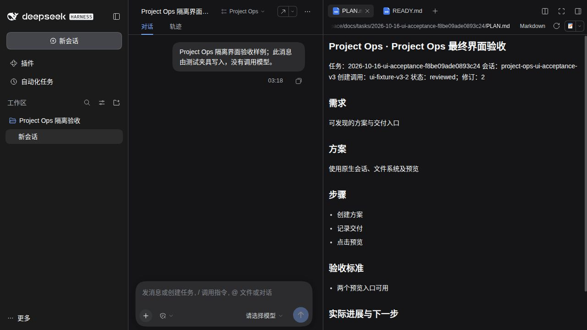

# Project Ops

Version 0.4.1 uses the Host’s shared text baseline when available; older Hosts keep their original layout. Menu, panel and Host behavior stay the same as 0.4.0.

[桌面端](https://github.com/Missher12/Missher-DeepseekHarness-Desktop) · [安装说明](INSTALL.md) · [开发任务文档](docs/TASK_DOCUMENTS.md)

Project Ops 为 DeepSeek Harness 提供项目任务发现、原生执行与验证回执，以及开发方案和交付记录。包名统一为 `@missher/dsh-project-ops`，沿用本仓库，没有新增兼容插件。

当前源码版本 **0.4.1**，面向 DeepSeek Harness 0.2 系列，不要求某个精确的 Host 版本。版本判据是能力而不是版本号：插件在激活时探测自己真正调用的方法，缺少可选能力（原生 Jobs 后台、客户端文件预览等）时只关闭对应功能并说明原因，不把整块入口静默撤下。

2026-10-17 在三个真实宿主上做过隔离验收（各自独立 HOME/DSH_HOME、合成工作区、无外部模型调用）：社区 rc.2（DSH 0.2.0-rc.2 / Cordis 4.0.4）、社区 alpha.2（0.2.1-alpha.2 / Cordis 4.0.5-alpha.1）、官方 npm alpha.5（0.2.1-alpha.5 / Cordis 4.0.5）。前两者是社区桌面封装，不是官方原始包。**已核验的只是这三个锚点，不是版本范围允许的全部版本**；最低接口、缺能力降级与未测范围见 [兼容性矩阵](docs/COMPATIBILITY.md)。

交付记录：本轮宽宿主兼容与界面修订见 [0.4.0 记录](https://github.com/Missher12/Missher-DSH-Project-Ops/blob/v0.4.0/docs/tasks/2026-10-14-wide-host-compat-5f76a32a7990cb98/READY.md)（含尚未验证项），此前的文档能力见 [0.4.0-alpha.1 记录](https://github.com/Missher12/Missher-DSH-Project-Ops/blob/v0.4.0/docs/tasks/2026-10-12-task-documents-44fc988/READY.md)。两处均指向仓库中的任务记录（不在 npm 包内），历史 0.3.1 的旧 Host 证据不能代替本版本验收。

## 找到入口

在启用插件并加载客户端的 DSH Web / Desktop 会话标题栏点击 **Project Ops**。入口是与宿主标题栏动作一致的轻量按钮（无浏览器默认按钮外观），面板只使用宿主 `--dsw-*` 主题变量，随亮/暗主题自动适配。

面板列出当前会话工作区的开发任务：以中文标题为主体，目录名仅在读不到标题时回退显示，完整目录名始终保留在任务行的 `title` 中。四种交付状态简洁区分——交付关联当前方案、历史交付（方案已更新）、待核对、尚未生成交付；**“关联当前”只表示记录与当前方案修订一致，不代表验收通过**。

任务行分两行排版：第一行约 13px 的任务标题（可两行、完整标题保留在 `title`），第二行是 12px 可读的短状态与行内的“方案 / 交付”文档入口；两者都是无边框、hover 才出现的轻量按钮，禁用时仍可见并在 tooltip 说明原因。

“方案 / 交付”打开宿主原生右侧文件预览；未生成的文档按钮禁用；打开文件后面板自动收起。面板固定在视口内并做钳制，窄宽度下内容内滚动；`Escape` 或点击面板外关闭，关闭后焦点回到入口按钮。刷新使用可取消读取（最多四并发），不会与上一次读取竞争。安装包存在、源码升级与当前桌面已启用是不同状态。

## 界面


会话标题栏的 **Project Ops** 入口打开后的面板（**亮色主题**）。截图取自 2026-10-17 的隔离合成验收：官方 npm 0.2.1-alpha.5 Web 宿主、独立合成 Profile、1280×720、无外部模型调用。任务行分两行——第一行是任务标题（长标题省略显示，完整文本保留在 tooltip），第二行是短状态与行内“方案 / 交付”入口；底部是只读说明。图中四种状态自上而下为：方案进行中、记录待核对（状态点用提醒色）、方案已更新、交付关联当前方案。



点击“方案”后，文档交给宿主原生的右侧栏预览打开（此图为**深色主题**，与上一张面板截图不是同一主题批次）；未生成的文档入口保持可见但禁用，并说明原因。

配图只说明界面形态，不构成发布、安装或功能验收。此前的 `task-panel.jpg`、`plan-preview.jpg` 记录的是 0.4.0-alpha.2 的单行任务行布局，保留为历史界面，不代表当前布局。

当前会话 Agent 在有一定规模的开发任务开始时维护 `docs/tasks/<日期>-<slug>-<身份摘要>/PLAN.md`，按进展续写，交付检查后写 `READY.md`。普通问答和极小修改不强制生成；生成方案后继续已授权开发，不新增审批门。正文由当前会话提供，不调用另一模型；失败、取消、未验证、未发布和未安装均保留事实，不把任意回复或 shell 退出当任务完成。

## 工具

原有七项能力保持：`missher_project_ops_task_list`、`task_plan`、`task_run`、`task_collect`、`verification_gate`、`capability_search`、`doctor`（后六项同样带 `missher_project_ops_` 前缀）。新增 `missher_project_ops_document_read` 与 `missher_project_ops_document_write` 管理独立开发任务文档。

任务发现只读取项目声明；执行仍交给 Agent 可见的原生 shell / Jobs。新版 Host 自动把前台等待超时命令转为后台时，Project Ops 保留原生 job ID 供收集与取消。插件不接受任意执行命令，不替代审批、沙箱、调度器或 Jobs。验证门复核回执和源码快照，未知证据不能判成功。

文档写入使用 Host 文件系统与会话策略、原子版本守卫和任务身份隔离。保护根 README/READY/AGENTS，检测人工编辑和中断，重启后从磁盘续写。READY 分开记录实现、验证、Git、发布、安装和限制；文件存在不表示所有工作已完成。不会自动推 Git。详细字段与恢复语义见 [任务文档说明](docs/TASK_DOCUMENTS.md)。

## 开发与验证

```sh
pnpm install --frozen-lockfile
pnpm typecheck
pnpm test
pnpm build
pnpm smoke:profile
```

使用 Node `^22.19.0 || >=24.0.0`。Profile smoke 只在本仓库 `.artifacts` 内创建隔离 DSH_HOME 和合成工作区，经正式 `dsh` Profile 安装、调用、卸载。它不等于真实模型、Electron、Intel Mac 或日常安装验收。

通用 Cordis 宿主可使用 `@missher/dsh-project-ops/cordis` 与 `projectOpsHost` 适配接口，原有执行能力保留；本轮新文档与客户端能力属于 Harness 入口。历史接口与证据见 [Cordis 集成](docs/CORDIS_INTEGRATION.md)、[旧官方验收](docs/OFFICIAL_COMPAT.md)。
