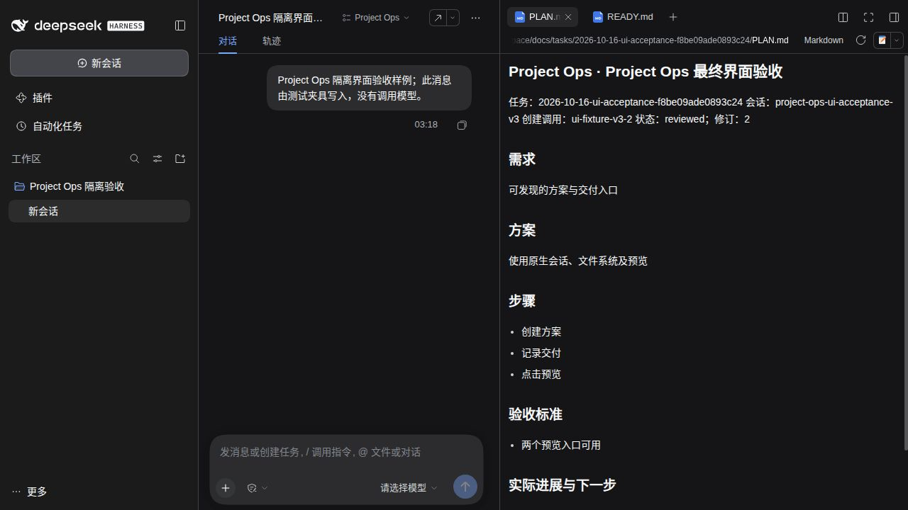

# Project Ops

Project Ops is the `@missher/dsh-project-ops` plugin for DeepSeek Harness. It puts one entry in the session header: browse the files this conversation registered next to the project's development plans, open a file in the Host's native right-sidebar preview, or reveal it in Finder and hand the actual file to someone by copy or drag-and-drop.

[Desktop app](https://github.com/Missher12/Missher-DeepseekHarness-Desktop) · [Install](INSTALL.md) · [Task documents](docs/TASK_DOCUMENTS.md)

## Current state

- Current version: **1.0.1**. Download the matching package and checksum from the [v1.0.1 Release](https://github.com/Missher12/Missher-DSH-Project-Ops/releases/tag/v1.0.1).
- Built for the DeepSeek Harness 0.2 series; compatibility is probed through the methods the plugin actually calls, not pinned to one exact Host version.
- A package existing, the source being upgraded and a profile having loaded the plugin are three different states; trust the source you installed and what the Host actually loaded.

## What you get

- **Session files**: the files this conversation registered — native `present` deliveries plus successful `write`, `edit` and `str_replace_editor` changes. The list comes from session history and may keep entries later moved or deleted; text listed in an `artifacts[]` report is not a file record.
- **Categories**: All, Plans, Word, Excel, PPT, PDF, Images, Media, Other, chosen by real extension; `plan.docx` is a Word file, never a development plan.
- **Native preview**: clicking a file name opens the Host's own right-sidebar file preview; whether content is rendered depends on the Host's support for that format.
- **Show in folder**: reveals and selects the file in Finder so you can copy the file itself or drag it into a chat window — not just copy its path.
- **Development plans**: the same panel lists this project's `docs/tasks` tasks and their "Plan / Delivery record" document entries.

## Use it

1. Install the plugin into the target profile (see [Install](INSTALL.md)).
2. Open a session and click **Project Ops** in the session header.
3. Filter by category; click a **file name** to open the native preview.
4. Click **Show in folder** on the same row: Finder opens with the file selected; copy or drag it from there.
5. Switch to the Plans area to open PLAN / delivery records. `Escape` closes the panel; `Tab` moves inside it.

## Categories and file sources

Categories are derived from the extension only, never from words such as "plan" in a name:

| Category | Extensions |
| --- | --- |
| Word | doc, docx, docm, odt, rtf |
| Excel | xls, xlsx, xlsm, xlsb, ods, csv, tsv |
| PPT | ppt, pptx, pptm, odp |
| PDF | pdf |
| Images | png, jpg, jpeg, gif, webp, svg, avif, bmp, tif, tiff |
| Media | mp3, wav, m4a, flac, ogg, mp4, mov, webm, mkv, avi |
| Other | everything else, including source code and text |

- One absolute path keeps only its latest record; identical file names in different directories stay separate and gain an extra directory line when a name would otherwise be ambiguous.
- The list follows the session's file records and is restored from Host history after a reload; at most the latest 1000 distinct paths are kept, and the limit is reported.
- "File index unavailable" and "no files" are different states with different copy; a missing capability is never rendered as an empty list.

## Search history

A short **Search** tab records this session's native search output; it is separate from delivered files and never adds a delivery:

- Sources: `glob` `meta.paths`, `grep` `meta.files[].path`, `web_search` `meta.sources[]` (title + http(s) URL), a successful `web_fetch` (`meta.url` with a 2xx `statusCode`) under **Opened pages**, and the `query` argument of `session_search`/`session_event_search`.
- Only structured metadata is stored — never grep hit lines, snippets or page bodies — and free text is never parsed back into paths.
- Local hits open the native preview and **Show in folder**; web sources are plain http(s) links. Hits are deduplicated within one call, and relative hits resolve against the tool's `working-directory/change`; a relative hit without a known absolute working directory is omitted instead of becoming a wrong clickable path.
- A failed call is shown as a failure and never contributes hits. Zero-hit searches are kept; Host truncation (`truncated`/`total`) and this plugin's own caps (50 searches, 100 paths and 50 sources per search) are reported as incomplete.
- History is per session. An older Host without the projection shows "search history unavailable", and replay fills only the native events the Host still retains (checkpoint/window) — it never re-runs a search. Session queries have no structured result metadata on this Host, so only their query is recorded ("results in the session"); their results are never parsed or copied.

## Plans and delivery records

- For a development task of real size the agent maintains `docs/tasks/<date>-<slug>-<identity>/PLAN.md`, continues it as work progresses and writes `READY.md` after the delivery review. Ordinary questions and tiny edits do not require one.
- Task rows carry four short states: delivery linked to the current plan, plan updated, record needs review, plan in progress. **"Delivery linked to the current plan" only means the record matches the current plan revision; it is not an acceptance, a release or an install.**
- Document entries open the native preview; missing documents stay visible but disabled with the reason in the tooltip. Opening one from the Plans area closes the panel.

## Preview, show in folder and missing files

- Clicking a file name asks the Host filesystem whether the path is still accessible before opening the native preview; a moved, deleted or unreadable file shows an inline error. Whether the file renders is up to the Host's support for its format, so not every file is guaranteed a content preview.
- "Show in folder" calls the Host's native session file-location action (`session/openWorkspacePath` with `reveal`). On macOS the Host runs `open -R`, which selects the file in Finder. The plugin never builds shell strings and never starts a service.
- A moved or deleted file keeps its row (history stays true); clicking preview or show-in-folder reports a short error so the user can deliver the file again.
- When the Host lacks file indexing, native preview or desktop reveal, only that capability is turned off with a notice; the panel and the other entries keep working instead of disappearing.

## Wide and narrow layouts

- The trigger matches the Host's session-header actions and uses `--dsw-*` theme tokens, so it follows light and dark themes.
- With room, it shows the full **Project Ops** label and chevron; when the title row is 640px or narrower (at most 640px) the trigger keeps only the icon (28×28), hiding label and chevron.
- The icon state keeps `title` and `aria-label` ("Project plans and files: N"), stays focusable with `Tab`, opens with `Enter` and closes with `Escape`; focus returns to the trigger.

## Verified scope

Real install and UI acceptance this round ran on **DeepSeek Harness 0.2.1-rc.4 on macOS desktop**:

- real Word and Excel files landed in the Word and Excel categories and opened in the native right-sidebar preview;
- the files were still listed after a page refresh;
- at a 491px-wide session title row the **Project Ops** entry was the 28px icon;
- `Tab`, `Enter` and `Escape` behaved normally; the icon state keeps `title` and `aria-label`;
- "Show in folder" selected the Word and the Excel file in Finder.

These are measured anchors, not acceptance for every platform, every Host version or every model setup. This round did not cover other platforms, older Hosts or every model combination.

## Install and update

Building a local package from the current `main` source, install, reload and removal live in [Install](INSTALL.md). Install with the desktop that matches the target profile: `dsh plugin --profile <profile> add <local.tgz>`, then reload the profile and **refresh the DSH page** to load the new client UI; confirm no load error and a **Project Ops** entry in the session header. The plugin manager's detail page reads `meta.detail` from the package's `locale/<language>.json` and shows the short intro in `docs/PLUGIN_DETAIL*.md`; the GitHub README stays detailed. Never pass an old source checkout's `lib` off as the frozen package.

## Develop and check

```sh
pnpm install --frozen-lockfile
pnpm typecheck
pnpm test
pnpm build
pnpm check:ui
```

On macOS, build with a Node that does not enable the hardened runtime: the DSH-bundled runtime rejects npm's unsigned native bindings (`mapped file has no cdhash`), while a non-hardened Node loads them. If a native binding crashes, remove `node_modules`, run `pnpm install --frozen-lockfile` again, then `pnpm build`; a failed build restores the previous `lib` instead of deleting it.

Node `^22.19.0 || >=24.0.0`. `pnpm test` covers host capabilities, file projection and client rendering; `pnpm check:ui` checks style classes and the UI contract; `pnpm smoke:profile` installs, calls and removes the plugin in an isolated temporary profile — that is not a real model, Electron or day-to-day install acceptance.

## History and screenshots

- 0.4.0 delivery records: [wide-Host compatibility and UI](https://github.com/Missher12/Missher-DSH-Project-Ops/blob/v0.4.0/docs/tasks/2026-10-14-wide-host-compat-5f76a32a7990cb98/READY.md) (including unverified items), [document capability](https://github.com/Missher12/Missher-DSH-Project-Ops/blob/v0.4.0/docs/tasks/2026-10-12-task-documents-44fc988/READY.md).
- The screenshots and those records are **0.4.0-era history**. They do not include this round's file categories, show-in-folder action or concise copy, do not represent current `main`, and are not release or install acceptance.




## Tools

Host tools: `missher_project_ops_task_list`, `task_plan`, `task_run`, `task_collect`, `verification_gate`, `capability_search`, `doctor`, `document_read`, `document_write` (all prefixed `missher_project_ops_`). Execution stays with the Agent's native shell / Jobs; the plugin accepts no arbitrary commands and never replaces approvals, sandboxing or the scheduler. The verification gate re-checks receipts and source snapshots, unknown evidence cannot pass, and nothing is pushed to Git automatically.

## Compatibility and more docs

[Compatibility matrix](docs/COMPATIBILITY.md) · [Task documents](docs/TASK_DOCUMENTS.md) · [Cordis integration](docs/CORDIS_INTEGRATION.md) · [Older official acceptance](docs/OFFICIAL_COMPAT.md)
