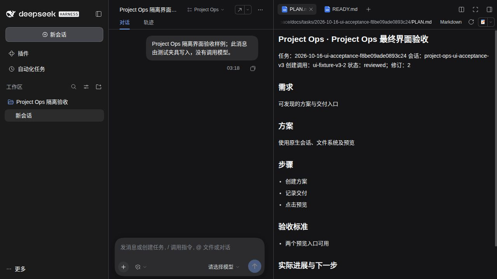

# Project Ops

Project Ops 是 DeepSeek Harness 的会话插件 `@missher/dsh-project-ops`。它在会话标题栏放一个入口：按分类查看当前会话已登记的实际文件和当前项目的开发方案；文件用宿主原生右侧预览打开，也可以在访达（Finder）中定位后复制或拖到聊天里发给别人。

[桌面端](https://github.com/Missher12/Missher-DeepseekHarness-Desktop) · [安装说明](INSTALL.md) · [开发任务文档](docs/TASK_DOCUMENTS.md)

## 当前状态

- `package.json` 版本仍为 **0.4.1**；当前 main 已包含文件分类、打开位置与精简界面等新改动。本次更新仅提交源码，**没有执行 npm 发布，也没有新增 tag**。
- 面向 DeepSeek Harness 0.2 系列；兼容性按插件真正调用的能力探测，而不是绑定某个精确的 Host 版本号。
- 安装包存在、源码已升级、目标 profile 已加载是三种不同状态；以实际安装来源和宿主实际加载结果为准。

## 能做什么

- **会话文件**：列出当前会话**已登记的实际文件**（原生 `present` 交付，以及成功的 `write`、`edit`、`str_replace_editor` 修改）。列表来自会话历史记录，可能保留后来被移动或删除的条目；报告 `artifacts[]` 里的文字不算文件登记。
- **分类浏览**：全部、方案、Word、Excel、PPT、PDF、图片、音视频、其他，按真实扩展名归类；`方案.docx` 属于 Word，不会被当成开发方案。
- **原生预览**：点文件名交给宿主右侧栏的文件预览打开，不自己渲染文档；能否显示内容由宿主对该格式的支持决定。
- **打开位置**：在访达中显示并选中该文件，随后可复制文件本身或拖到聊天窗口，而不是只拿到一段路径。
- **开发方案**：同一面板里列出当前项目的 `docs/tasks` 任务，以及“方案 / 交付记录”文档入口。

## 快速使用

1. 在目标 profile 安装并加载插件（见[安装说明](INSTALL.md)）。
2. 打开任一会话，点标题栏的 **Project Ops**。
3. 用分类筛选文件；点**文件名**打开宿主原生预览。
4. 点同一行的**打开位置**，访达会显示并选中该文件，之后复制文件或拖到聊天即可。
5. 切到“方案”区打开 PLAN / 交付记录；`Escape` 关闭面板，`Tab` 在面板内移动。

## 文件分类与来源

分类只看扩展名，与文件名里的词语无关：

| 分类 | 扩展名 |
| --- | --- |
| Word | doc、docx、docm、odt、rtf |
| Excel | xls、xlsx、xlsm、xlsb、ods、csv、tsv |
| PPT | ppt、pptx、pptm、odp |
| PDF | pdf |
| 图片 | png、jpg、jpeg、gif、webp、svg、avif、bmp、tif、tiff |
| 音视频 | mp3、wav、m4a、flac、ogg、mp4、mov、webm、mkv、avi |
| 其他 | 其余扩展名，包括源码与文本 |

- 同一绝对路径只保留最新一条记录；不同目录下的同名文件分别保留，并在名字冲突时额外显示一行目录。
- 列表随会话文件记录更新，重载后由宿主历史恢复；最多保留最近 1000 个不同路径，达到上限会提示。
- 文件索引不可用与“暂无文件”是两种状态，分别提示，不会把缺少能力说成没有文件。

## 方案与交付记录

- Agent 在有一定规模的开发任务开始时维护 `docs/tasks/<日期>-<slug>-<身份摘要>/PLAN.md`，按进展续写；完成交付检查后写 `READY.md`。普通问答和极小修改不强制生成。
- 任务行用四种短状态区分：交付关联当前方案、方案已更新、记录待核对、方案进行中。**“交付关联当前方案”只表示记录与当前方案修订一致，不代表验收通过、发布或安装。**
- 文档入口打开宿主原生预览；未生成的入口禁用并在提示里说明原因；从方案区打开文件后面板自动收起。

## 预览、打开位置与失效文件

- 点文件名先经宿主文件系统确认该路径仍可访问，再打开原生预览；文件被移动、删除或权限拒绝时在行内显示错误。是否渲染出内容由宿主对该格式的支持决定，不保证每份文件都有内容预览。
- “打开位置”走宿主原生的会话文件定位动作（`session/openWorkspacePath` 的 `reveal`）；macOS 上由宿主执行 `open -R`，直接在访达中选中文件。插件不拼接 shell 命令、不新建服务。
- 文件移动或删除后，行仍会保留（历史事实）；点击预览或打开位置会得到简短错误提示，用户可以据此重新交付文件。
- 宿主缺少文件索引、原生预览或桌面定位能力时，只关闭对应能力并给出提示，面板与其他入口继续可用，不会整块消失。

## 宽栏与窄栏

- 入口与宿主标题栏动作一致，使用 `--dsw-*` 主题变量，跟随亮/暗主题。
- 标题行空间充足时显示完整 **Project Ops** 文字与下拉箭头；标题行缩到 640px 及以下时入口只保留图标（28px 见方），文字和箭头隐藏。
- 图标态仍保留 `title` 与 `aria-label`（“项目方案与文件：N 项”），键盘 `Tab` 可聚焦、`Enter` 打开、`Escape` 关闭，关闭后焦点回到入口。

## 已核验范围

本轮在 **DeepSeek Harness 0.2.1-rc.4 / macOS 桌面**上做了真实安装与界面验收：

- 真实的 Word 与 Excel 文件分别归入 Word、Excel 分类，点文件名可打开右侧原生预览；
- 刷新界面后文件仍在列表中；
- 会话标题行收窄到 491px 时，“Project Ops”入口显示为 28px 图标；
- `Tab`、`Enter`、`Escape` 正常，图标态保留 `title` 与 `aria-label`；
- 点“打开位置”后，访达分别选中了 Word 和 Excel 文件。

这是已实测的锚点，不是全部平台、全部 Host 版本或全部模型环境的验收；本轮未覆盖其他平台、旧 Host 及所有模型组合。

## 安装与更新

从当前 main 源码打包、安装、重载与卸载步骤见[安装说明](INSTALL.md)。通过目标桌面匹配的 `dsh plugin --profile <目标profile> add <本地.tgz>` 安装，重载 profile 并**刷新 DSH 页面**后确认插件无加载错误、会话标题栏出现 **Project Ops**。插件管理器的详情页读取包内 `locale/<语言>.json` 的 `meta.detail`，显示简短介绍（`docs/PLUGIN_DETAIL*.md`）；GitHub 的 README 保留详细说明。不要用旧源码的 `lib` 冒充冻结包。

## 开发与检查

```sh
pnpm install --frozen-lockfile
pnpm typecheck
pnpm test
pnpm build
pnpm check:ui
```

使用 Node `^22.19.0 || >=24.0.0`。`pnpm test` 覆盖服务端能力、文件投影与客户端渲染；`pnpm check:ui` 校验样式类与界面契约；`pnpm smoke:profile` 在本机隔离的临时 profile 内做安装/调用/卸载检查，它不等于真实模型、Electron 或日常安装验收。

## 历史记录与截图

- 0.4.0 交付记录：[宽宿主兼容与界面修订](https://github.com/Missher12/Missher-DSH-Project-Ops/blob/v0.4.0/docs/tasks/2026-10-14-wide-host-compat-5f76a32a7990cb98/READY.md)（含尚未验证项）、[文档能力](https://github.com/Missher12/Missher-DSH-Project-Ops/blob/v0.4.0/docs/tasks/2026-10-12-task-documents-44fc988/READY.md)。
- 下方截图与上述记录都是 **0.4.0 时期的历史界面**，未包含本轮的文件分类、打开位置和精简文案，不代表当前 main 源码界面，也不构成发布或安装验收。




## 工具

服务端工具：`missher_project_ops_task_list`、`task_plan`、`task_run`、`task_collect`、`verification_gate`、`capability_search`、`doctor`、`document_read`、`document_write`（均带 `missher_project_ops_` 前缀）。执行仍交给 Agent 可见的原生 shell / Jobs，插件不接受任意命令、不替代审批、沙箱或调度器；验证门复核回执与源码快照，未知证据不能判成功；不会自动推 Git。

## 兼容性与更多文档

[兼容性矩阵](docs/COMPATIBILITY.md) · [任务文档说明](docs/TASK_DOCUMENTS.md) · [Cordis 集成](docs/CORDIS_INTEGRATION.md) · [旧官方验收](docs/OFFICIAL_COMPAT.md)
